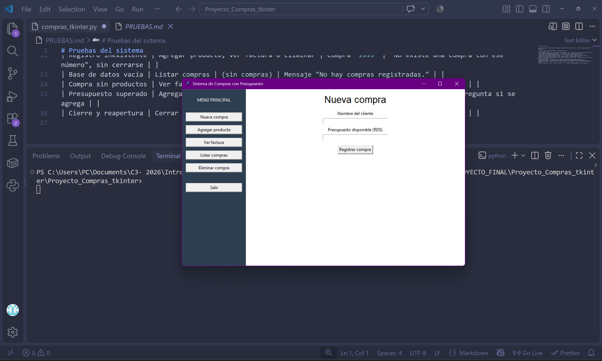
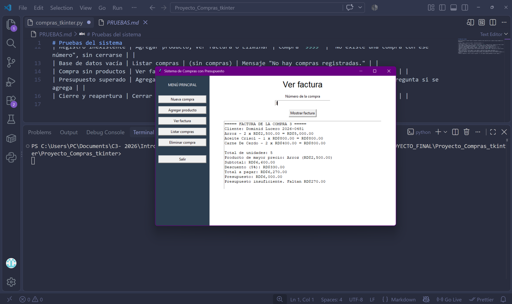

# Sistema de Compras con Presupuesto

Aplicación de escritorio con menú lateral (tkinter) que registra compras, calcula descuentos y avisa si el total supera el presupuesto del cliente. Los datos se guardan en SQLite.

## Problema que resuelve

Cuando una persona va a comprar con un presupuesto limitado, llevar las cuentas a mano provoca errores de cálculo, olvidos del descuento que corresponde y dificultad para saber cuánto dinero sobra o falta.

Este sistema permite registrar cada compra con sus productos, calcular automáticamente el subtotal, el descuento y el total, y comparar el resultado con el presupuesto. La información queda guardada aunque se cierre el programa.

## Características principales

- Registrar una compra con el nombre del cliente y su presupuesto.
- Agregar productos (nombre, precio y cantidad) a una compra.
- Aviso cuando un producto hace que se supere el presupuesto, con opción de agregarlo o no.
- Factura con total de unidades, producto de mayor precio, subtotal, descuento, total a pagar y dinero que sobra o falta.
- Descuento automático: 5 % desde RD$5,000 y 10 % desde RD$10,000.
- Listado de todas las compras guardadas.
- Eliminación de una compra con confirmación.
- Validación de todas las entradas: el programa no se cierra por datos incorrectos.

## Tecnologías utilizadas

- Python 3.12 o superior
- tkinter (interfaz gráfica)
- sqlite3 (base de datos)
- math (validación de números)

No se usan librerías externas.

## Requisitos previos

- Python 3.12 o superior instalado ([python.org](https://www.python.org/downloads/)).
- tkinter incluido (en Windows y macOS viene con Python; en Linux: `sudo apt install python3-tk`).

## Instalación paso a paso

1. Descargar o clonar el repositorio:
   ```bash
   git clone <URL-DEL-REPOSITORIO>
   cd Proyecto_Compras_tkinter
   ```
2. (Opcional) Crear y activar un entorno virtual:
   ```bash
   python -m venv venv
   venv\Scripts\activate        # Windows
   source venv/bin/activate     # Linux o macOS
   ```
3. No hay dependencias que instalar (`requirements.txt` está vacío a propósito).

## Uso y ejemplo de ejecución

```bash
python compras_tkinter_corto.py
```

Se abre la ventana con un menú lateral. Ejemplo de uso:

1. **Nueva compra**: cliente `Ana`, presupuesto `6000` → "Compra registrada con el número 1".
2. **Agregar producto**: compra `1`, `Arroz`, precio `2500`, cantidad `2`.
3. **Agregar producto**: compra `1`, `Aceite`, precio `800`, cantidad `1`.
4. **Ver factura**: compra `1` → subtotal RD$5,800.00, descuento 5 %, total RD$5,510.00, sobran RD$490.00.

La primera vez que se ejecuta se crea el archivo `compras.db` en la misma carpeta.

## Estructura de carpetas

```text
Proyecto_Compras_tkinter/
├── compras_tkinter_corto.py   # Programa principal (interfaz, lógica y base de datos)
├── README.md                  # Esta documentación
├── PRUEBAS.md                 # Casos de prueba del sistema
├── requirements.txt           # Dependencias (ninguna externa)
├── .gitignore                 # Archivos que no se suben a GitHub
└── capturas/                  # Capturas de pantalla del programa
```

## Capturas de pantalla
## Capturas de pantalla




 

## Autor

- **Autor:** Dominid Lucero 
- **Curso:** Fundamentos de la Programación, Sección 2
- **Profesor:** Daysson Crissauris
- **Institución:** Instituto Tecnológico de las Américas (ITLA)
